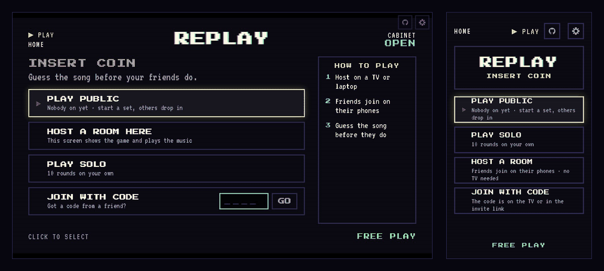
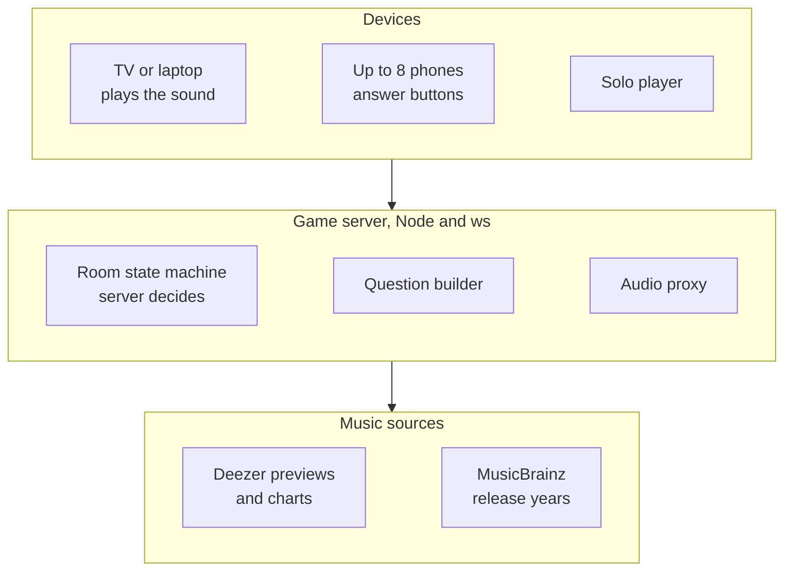
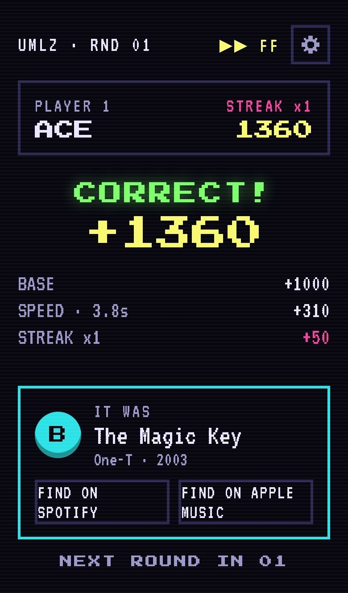

<p align="center"></p>

# Replay

**A live guess-the-song game styled as an arcade cabinet: a clip plays, everyone picks A, B, C or D, and the fastest correct answers score most.** Play on a TV with phones as buttons, in a private room with friends on a call, or in one public room.

**[Play it → replay.bhanusadhu.com](https://replay.bhanusadhu.com)** · free, no sign-up, nothing to install



## The problem

Music quiz games are best in a room, and the ones online make you pick between two bad options: a solo game with no one to beat, or a setup that needs an account, an app, or every guest to use the same device. A party needs something a stranger can join in ten seconds from a code, and a call with friends needs the same game with no TV.

Replay aims for one outcome: **a full game with friends running within a minute of the first person opening the page.**

## How it works

1. **Pick a mode.** *Party*: one TV or laptop shows the game and plays the music while phones are the buttons. *Remote*: a private room where every phone plays the clip. *Public*: one always-on room anyone can drop into. *Solo*: ten rounds on your own.
2. **Join with a code.** Up to eight players enter a four-letter code and pick three-letter initials, and the first phone in becomes host.
3. **Guess.** A 15-second clip plays. Pick one of four songs before your friends do, for 1,000 points plus up to 500 for speed and up to 250 for a streak.
4. **See the reveal.** The song, who picked what and a points breakdown appear, with links to find the track on Spotify or Apple Music.
5. **Vote to replay.** After ten rounds a majority vote starts another game with the same rules.


## Product decisions

| Decision | Trade-off |
| --- | --- |
| **Multiple choice only** | Anyone can play and the server can score instantly, but a typed answer would test knowledge harder and allow more skill. |
| **Phones are the controller in Party mode** | No app and no accounts, and the TV plays all the sound. Every guest needs a phone with a browser and a signal. |
| **Three-letter initials, no accounts** | Zero friction and nothing to moderate beyond a short blocklist. There is no identity, so no history and no friends list. |
| **Music from Deezer's 30-second previews** | No licensing work and no paid API, but only songs with a public preview can appear, and a clip is half of one. |
| **The server decides everything** | A device cannot fake a score, and a reload cannot desync a room. Rooms live in server memory, so a restart clears them. |
| **Free hosting on Vercel and Render** | $0, but Render's free server sleeps after 15 minutes idle and takes up to a minute to wake. A warm-up screen and a scheduled ping soften that and do not remove it. |

## Architecture



The website is a Vite and React app on Vercel. The Node game server on Render holds every room in memory, speaks WebSocket and proxies the clips. The `shared` package holds message types, timings and scoring so the client and server cannot disagree. The room moves from lobby through intro, guessing and reveal for ten rounds, then a replay vote, and pauses if the TV or host drops.

## Hard problems

**Fair scoring over phones with different lag.** Speed counts, so a slow connection must not lose points unfairly or let anyone cheat. Devices sync clocks with a ping and pong, and the server measures answer time itself. A device may claim to be at most **2 seconds** faster than the server saw, a guess counts only once the music has started, and a short grace period covers the clip's end. See [server/src/game.ts](server/src/game.ts).

**Rooms that survive real phones.** Phones reload, lose signal and lock their screens. A dropped phone keeps its seat and score for **60 seconds** through a session token, a dropped host keeps the role for 10 seconds, a 12 second server heartbeat notices silent drops, and the game pauses and replays the interrupted round when the TV reconnects. The room closes if the TV stays gone for 60 seconds. Scripts in [server/scripts](server/scripts) drive these cases against a running server.

**Wrong answers that sound right.** Random wrong options make a round trivial. The question builder in [server/src/music](server/src/music) ranks candidates by how close they are to the answer: a related artist counts most, then the same genre or a nearby year. Decade mixes would otherwise include re-releases, so each song's original release year is looked up on MusicBrainz and songs from the wrong era are dropped.

**A free server that falls asleep.** Render puts the server to sleep after 15 minutes without traffic. The site checks `/health` on load and shows a "WARMING UP THE CABINET" screen until it answers, live connections keep the server awake during play, and a scheduled workflow pings it every 10 minutes. That uses about 744 of Render's 750 free hours, so it only fits while Replay is the account's one always-on service.



## Results

- **65 unit tests in 10 files** (Vitest). They cover scoring, the room state machine, message validation, the initials blocklist, abuse limits, the public room, mix and question building, and the on-screen text.
- **Scoring is deterministic and documented:** a correct answer scores 1,000 plus a speed bonus up to 500 plus a streak bonus up to 250, so a perfect ten-round game is **17,500**.
- **Six scripts play real games against a running server** with simulated phones: a full room with a TV and six phones, the public room, host controls, the replay vote timer, resilience and abuse limits. They are run by hand, so there is no recorded pass rate.
- **Abuse limits** are sized so a full party behind one Wi-Fi address (a TV and eight phones reloading together) never reaches them: 40 open sockets per IP and a token bucket on messages, joins and audio requests.

**Not measured:** how many people play, how the game holds up with many simultaneous rooms, latency on real mobile networks, and any playtest data. Continuous integration only runs the keep-awake ping, not the tests.

## How it was built

- **Scaffold and design system.** A workspace with a shared package, a `ws` server and a client, then the arcade visual system on the round screens.
- **One real round.** A single-player round with real music before any multiplayer.
- **Rooms.** A shared round engine for Party and Remote modes, then the replay vote.
- **The public room.** An always-on room that runs sets of ten rounds.
- **Resilience.** Held seats, resume after reloads, heartbeats, TV pause and host controls, each checked with a script.
- **Hardening and polish.** Rate limits, cold-start handling, link previews, and fixes found by playing it, such as sound effects sitting far below the music and answers counting before the music began.

## Tech stack

| Layer | Technology |
| --- | --- |
| Client | Vite, React, TypeScript, Press Start 2P and VT323 fonts |
| Server | Node 24, `ws`, an in-memory room state machine |
| Shared | One TypeScript package with messages, timings and scoring |
| Music | Deezer public API for previews and charts, MusicBrainz for release years |
| Testing | Vitest and simulation scripts |
| Hosting | Vercel Hobby for the site, Render free tier for the server, $0 |

## Run it locally

```bash
npm install
npm run dev                          # server on :8787 and client together
npm run check                        # typecheck, lint, unit tests
npm run simulate -w server           # play a full room game with simulated phones
```

Phones on the same Wi-Fi can join a local game, because development accepts any origin. In production the server accepts only the website's origin (`ALLOWED_ORIGINS`), and the client reads the server address from `VITE_SERVER_URL`.

## Project structure

```text
shared/   message types, timings, scoring, room rules, initials blocklist
server/   WebSocket server, room state machine, question builder, audio proxy
  scripts/  simulation and resilience checks against a running server
client/   Vite React app: screens, components, networking, audio
render.yaml   game server on Render's free tier
PLAN.md       the build plan, rules and design tokens
```

## What's next

**Known limits**

- Rooms live in server memory, so a restart ends them, and "Today's best" in the public room resets on a redeploy.
- Only songs with a Deezer preview can appear, and the first player after an idle period can still wait for the server to wake.
- There are no accounts, so no history and no friends list.
- Tests are not run automatically on push.

**Next:** run the tests and simulation scripts in CI, measure latency and room capacity under load, and playtest with real groups.

[Build plan](PLAN.md)
