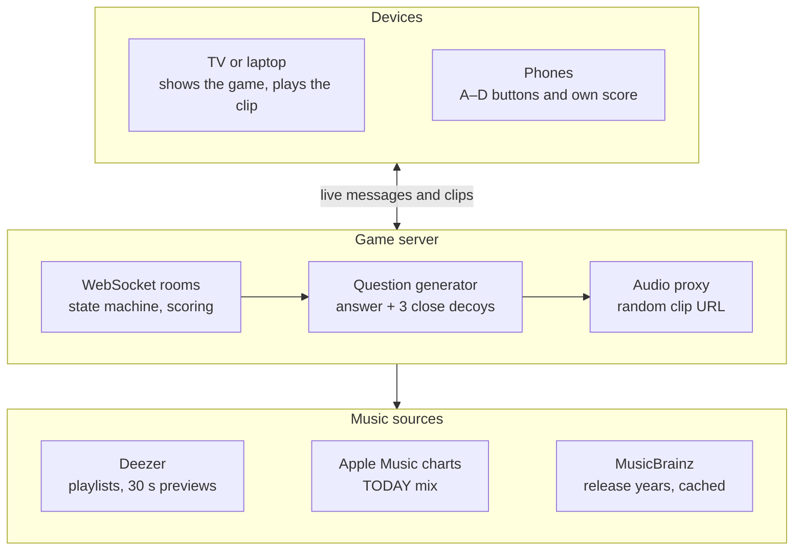

<p align="center"></p>

# Replay

**A guess-the-song party game built like an arcade cabinet.** A TV plays a short clip, everyone's phone becomes an A–D button, and the fastest correct answer scores the most.

**[Play it → replay.bhanusadhu.com](https://replay.bhanusadhu.com)** · free, no accounts, works with one phone or eight.


## The problem

Music trivia at a party usually means one person reading questions off their phone, or an app where everyone stares at their own screen and hears the song at slightly different times. Friends on a video call have it worse: nobody can share a speaker. The fun part, everyone hearing the same three seconds and racing to name it, gets lost.

The goal: **a room of people playing together within a minute of opening the site, with no app, no sign-up and a fair race.**

## How it works

1. **Host.** A TV or laptop taps HOST A ROOM and shows a four-letter code. That screen plays the music.
2. **Join.** Phones open the site, type the code (or tap an invite link) and pick three-letter initials. The first phone in becomes the host and sets the rules: 5, 10 or 15 rounds, a 10, 15 or 20 second clip, and a mix (80s, 90s, 2000s, THROWBACKS or TODAY).
3. **Guess.** A clip plays and four song titles appear. Each phone taps A, B, C or D. Faster correct answers earn more.
4. **Reveal.** The answer glitches onto the TV, each phone shows its own points, and the leaderboard updates. After the last round come awards and a REPLAY? vote.

No TV? A phone can host a **remote** room where every phone plays the clip, which works for friends on a call. There is also an always-on **public** room and a **solo** mode.

<p align="center">
  
  &nbsp;
  
</p>

## Product decisions

| Decision | Trade-off |
| --- | --- |
| **The TV is the speaker, phones are the buttons** | Party mode needs a shared screen. In return everyone hears the clip from one speaker at the same instant, so nobody gets a head start from their own device. Remote mode covers groups without one. |
| **Multiple choice, not typing** | A blind guess has a 1-in-4 chance. But tapping is instant on a phone, nobody loses on spelling, and speed becomes the skill. |
| **Speed is worth up to half a correct answer** | 1,000 for being right, up to 500 for being fast, up to 250 for a streak. Rewarding speed makes every round tense; capping the streak keeps an early leader from running away. |
| **Decoys that sound like the answer** | Picking wrong options takes extra lookups for related artists, genres and years. Random decoys made rounds trivial: one rap song among country songs answers itself. |
| **Three-letter initials, no accounts** | No profiles or history beyond a rolling 24-hour public high score. But joining takes seconds, and it feels like an arcade. A blocklist rejects rude initials. |
| **Free hosting** | The game server sleeps after 15 idle minutes and takes about a minute to wake. The site says "WAKING THE SERVER" and queues your tap, and a scheduled ping keeps it awake. |

## Architecture



The server owns every rule: rounds, timing, scoring and who is host. Rooms live in its memory, and the browsers only render state and send taps. The site runs on Vercel and the game server on Render. Both share one TypeScript package of message types, constants and scoring, so they can't disagree. → [`shared/src`](shared/src)

## Hard problems

**A fair race across devices.** Each phone hears the clip at a slightly different moment, so the server can't time answers from when messages arrive. Each device times its own answer from when its audio actually started. The server accepts that, but never more than **2 s** faster than what it saw itself, and drops guesses after the clip plus 0.5 s. Playtesting found a hole: during the 1.5 s preload the buttons were already live, and a tap counted as a **0.0 s** answer with full speed points. Taps now count only once the clip starts. → [`server/src/game.ts`](server/src/game.ts)

**Keeping the answer secret.** If a phone knew the track ID it could look up the answer. The server downloads each clip and serves it from `/audio/<random id>`, so nothing in the URL or the four shuffled options says which one is right until the reveal. The proxy supports range requests, which iPhone Safari needs for audio. → [`server/src/audio.ts`](server/src/audio.ts)

**Music that fits the mix.** Deezer's editorial "80s Hits" playlists slip in songs from other decades, and its chart was full of decades-old catalog songs. Decade mixes now check each song's original release year on MusicBrainz (**281** songs, cached in `years.json`) and drop off-era ones. TODAY uses Apple Music's most-played charts for the US and UK instead, keeping songs from the last two years, at most 3 per artist. Decoys are scored by closeness: a related artist counts most, then the same genre or a nearby year, with some randomness so the same songs don't keep repeating. → [`server/src/music`](server/src/music)

**Phones that drop.** Reloads, locked screens and bad Wi-Fi are normal at a party. A dropped phone keeps its seat and score for **60 s** using a token stored on the device. A host gets **10 s** before the role passes on. If the TV drops, the room pauses and replays the interrupted round when it returns. A 12 s heartbeat catches connections that die without saying goodbye. → [`server/src/rooms.ts`](server/src/rooms.ts)

## Results

- **65** unit tests. They check the scoring rules against worked examples (7.2 s into a 15 s clip on a 4-answer streak is exactly **+1,460**; a perfect game is capped at **17,500**). They check that the question generator never repeats an answer and spreads the right letter across A–D, that a related artist outranks a nearby year as a decoy, and that the protocol rejects malformed, unknown and oversized messages.
- **6** scenario scripts that play against a running server over real WebSockets: a full game with 1 TV and 6 phones (one leaves midway) that checks lock-in counts, every phone's result and the sorted final board; drops and resumes; host controls; the replay-vote timeout; the public room; and the rate limits. → [`server/scripts`](server/scripts)
- **Abuse limits** per IP: 40 open sockets, a token bucket for new connections, joins and audio, and a per-connection message budget that closes a flooding socket. One party of a TV plus 8 phones stays far below all of them. → [`server/src/limits.ts`](server/src/limits.ts)

The demo above is a real game on the live site. The phone answered in 3.8 s of a 10 s clip: 1,000 + 310 for speed (500 × (1 − 3.8 ÷ 10)) + 50 for a first-answer streak = **+1,360**, exactly what the reveal shows.

Not measured yet: how many games people finish, how often they vote to replay, and how hard each mix is in practice. There is no analytics.

## How it was built

1. **Plan first.** A written spec covered every screen, rule, message type and milestone before the first line of code, with the arcade look decided from mockups.
2. **One round, then rooms.** The design system and static screens came first, then a single-player round with real music, then rooms with party and remote modes, the replay vote and the public room.
3. **Real life breaks things.** Held seats, resume after reload, host handoff and TV pause. The resilience checks were rewritten to hold up over the internet, not just on localhost.
4. **Shipping for free.** Rate limits, a wake-up screen for the sleeping server, joins queued until the connection is up, and a scheduled ping.
5. **Playtest fixes.** The 0.0 s speed bug, sound effects measured about **25 dB** under the music on phone speakers, a TODAY mix full of old songs, and decoys that didn't sound like the answer.

## Tech stack

| Layer | Technology |
| --- | --- |
| Client | Vite, React, TypeScript, Web Audio |
| Server | Node.js, `ws` WebSockets, rooms in memory |
| Shared | One TypeScript package: protocol, constants, scoring |
| Music | Deezer API (clips), Apple Music charts, MusicBrainz (release years) |
| Testing | Vitest, WebSocket scenario scripts |
| Hosting | Vercel Hobby (site), Render free tier (game server), both free |

## Run it locally

```bash
npm install
npm run dev                  # game server + site together; open the URL Vite prints
npm run check                # typecheck, lint and unit tests
npm run simulate -w server   # play a full game: 1 TV + 6 phones against the local server
npm run years -w server      # refresh decade release years from MusicBrainz
```

In production the site reads the game server's address from `VITE_SERVER_URL`, and the server only accepts the origins in `ALLOWED_ORIGINS`. The site deploys from `main` on Vercel; the server is described in `render.yaml`.

## Project structure

```
shared/src/        # Message types and validation, constants, scoring, room rules, blocklist
server/src/
├── rooms.ts       # Room lifecycle: join, seats, host handoff, pause
├── game.ts        # Rounds, guess timing, reveal, awards
├── public.ts      # The always-on public room
├── audio.ts       # Clip proxy with random URLs
├── limits.ts      # Per-IP and per-connection rate limits
└── music/         # Deezer, Apple charts, decade filtering, question generator
server/scripts/    # Scenario scripts against a running server
client/src/        # Screens, arcade UI components, connection and clock sync, audio
```

## What's next

Known limits:
- Rooms live in server memory, so a deploy or restart ends games in progress and clears the public high scores.
- The free server sleeps; the first visitor after a quiet spell waits up to a minute.
- Clips are Deezer's 30-second previews, so a song without one can't be used.

Next to measure: games finished vs started, replay-vote rate, and the share of correct answers per mix, which would show whether the decoys are too easy or too hard.
