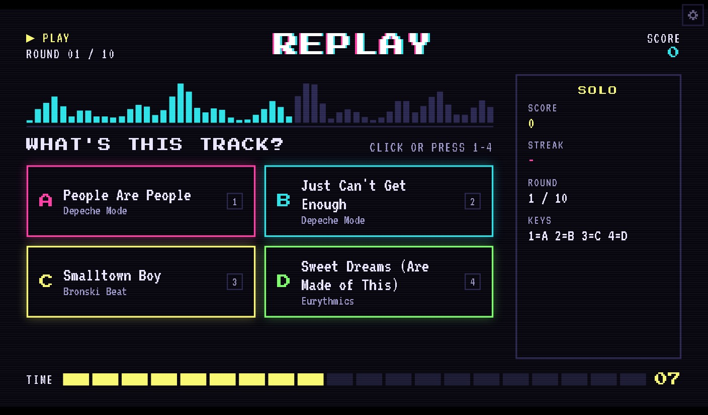
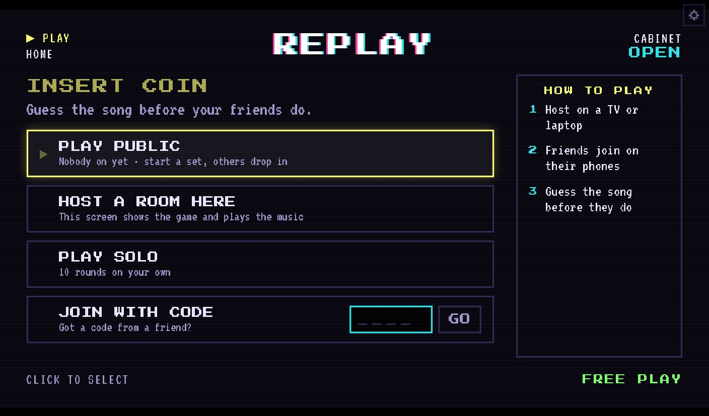
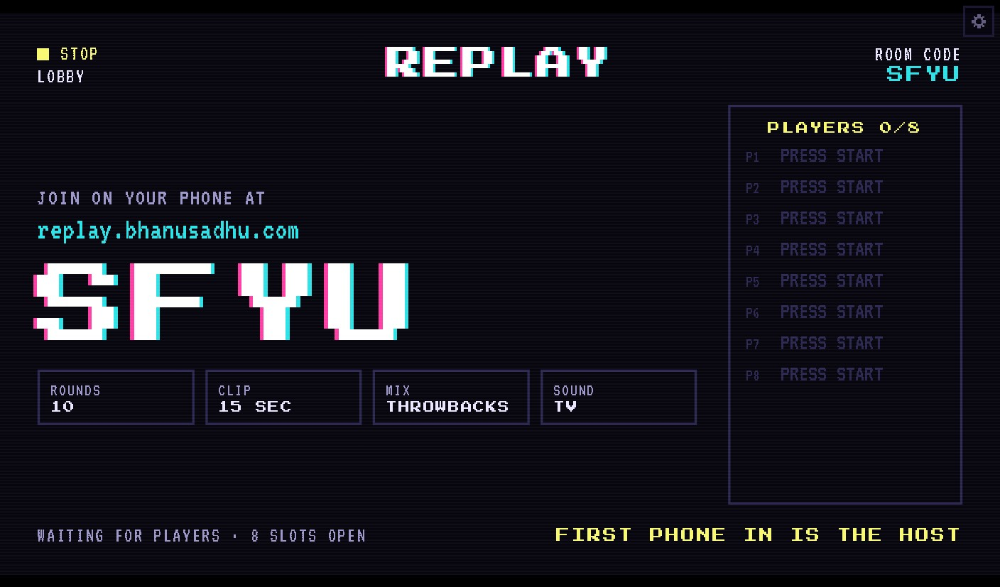
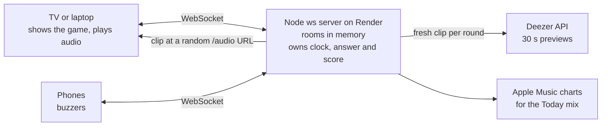

# Replay

**Guess the song before your friends do.** A live multiplayer music game with an arcade cabinet look: one screen plays the clip, every phone is a buzzer, and the fastest correct answer scores the most.

**[Play it → replay.bhanusadhu.com](https://replay.bhanusadhu.com)** · free, no sign-up, no app to install



<p align="center">
  
  
</p>

## The problem

Music quizzes at a party usually mean one person reading questions off a phone, or a trivia app where everyone stares at their own screen. I wanted the feel of a game show: the music in the room, everyone answering at once, and the scoreboard on the TV. It had to start in seconds, with nothing to download and no accounts, and it had to work for friends who are not in the same room.

Inspiration: [Mixtape](https://mixtape-game.fly.dev/), a single global song-guessing station. Replay adds private rooms, a party mode built around one shared screen, remote play, and an arcade identity of its own.

## How it plays

A 15 second clip plays, everyone picks A, B, C or D, and the reveal shows who got it. Ten rounds make a game.

| Mode | Who plays the sound | For |
| --- | --- | --- |
| **Party** | Only the TV or laptop that hosts. Phones stay silent and act as buzzers. | A room full of people |
| **Remote** | Every phone plays its own clip | Friends on a call |
| **Public** | Every device, in one always-on room with a top 10 | Dropping in alone |
| **Solo** | Your device | Ten rounds on your own |

Five mixes: Throwbacks, 80s, 90s, 2000s, and Today (what is on the charts now).

## What is built

| Feature | What it does |
| --- | --- |
| **Private rooms** | A four-letter code and an invite link, up to 8 players, 3-letter arcade initials |
| **Party mode** | The TV shows the round, the answers and the HI-SCORE table; phones are buttons |
| **Host controls** | Pause, skip a song, end the game, or remove a player from the host's phone |
| **Public room** | Runs nonstop in sets of 10, rotates mixes, shows a top 10 plus your own row |
| **REPLAY? vote** | A 10 second vote after each game; a majority runs it back with the same rules |
| **Reconnects** | A dropped phone keeps its seat and score for 60 seconds |
| **Arcade look** | Scanlines, pixel type, a segmented timer, VHS status labels for each stage, and a Reduce effects switch |

## Product decisions

| Decision | Trade-off |
| --- | --- |
| **Multiple choice only** | Typing a title is slow on a phone and punishes spelling, not ears. Four options keep a round to seconds, at the cost of some guessing luck. |
| **Wrong options that sound like the answer** | Random wrong options make a round trivial. Options are ranked by closeness to the answer: a related artist counts most, then the same genre or a nearby year, with a little randomness so the same decoys do not repeat. |
| **Reward speed and streaks, never punish a wrong answer** | 1,000 for a correct answer, up to 500 more for speed, up to 250 for a streak. No penalty keeps quiet players guessing instead of freezing. |
| **Each device times itself from its own clip start** | A slow connection should not count as a slow answer. Claimed lag is capped at 2 seconds so it cannot be gamed. |
| **One color, one meaning** | Pink, cyan, yellow and green are always A, B, C and D, so a TV across the room and a phone in your hand match at a glance. |
| **No accounts** | Initials are enough for a party game. Seats are held with a token on the device, so a reload does not lose your score. |
| **$0 to host** | The site is on Vercel and the game server on Render's free tier, which sleeps when idle. A "waking the server" screen queues the first tap instead of failing it. |

## Architecture



* **The server decides everything.** Rooms are a server-owned state machine (lobby, round, reveal, game over, vote). Clients send intents and render what the server says, so nobody can score themselves.
* **One typed protocol.** A `shared/` package holds every message type, the scoring and the room rules, imported by both the client and the server.
* **Clips never reveal the track.** The server fetches a fresh Deezer preview for each round and serves it at a random `/audio/<id>` URL, with range requests because iPhone Safari needs them.
* **Song sourcing.** Today uses Apple Music most-played charts matched to Deezer clips. Decade mixes use Deezer editorial playlists, filtered by original release years from MusicBrainz so a remaster does not sneak into the wrong decade.
* **Resilience.** A 12 second heartbeat notices dropped sockets, a host keeps the role for 10 seconds through a reload, seats are held for 60 seconds, and a TV that drops pauses the room and replays the round when it returns.
* **Abuse limits.** Token buckets cap connections, messages, room-code tries and audio requests per visitor, keyed on the address Cloudflare passes through, and sized so a full party on one Wi-Fi never comes close.

## Quality

* **65 Vitest tests** across `shared/`, `server/` and `client/`: scoring, room rules, the protocol, the initials blocklist, mixes, decoy selection, the public room and rate limits.
* **Simulation scripts that play real games** over WebSockets, including against production: one TV and six phones through a full game, vote, kick and host handoff; the public room; host controls; the vote timing out; drops, rejoins and seat expiry; and rate limits.
* **Tested in iPhone Safari** on the iOS simulator against production: audio plays on remote phones, stays silent on party-mode phones, and taps and reveals land.

## Known limits

* Rooms live in server memory, so a deploy or restart ends the games in progress.
* The free server sleeps when idle; the first visitor can wait up to a minute.
* Clips come from Deezer's 30 second previews, so song choice is limited to what Deezer offers.
* There is no real-user data yet, so no engagement numbers are claimed.

## Develop

Requires Node 24.

```bash
npm install
npm run dev      # game server on :8787, website on :5173
```

Open http://localhost:5173. To test on a phone, open `http://<your-laptop-ip>:5173` on the same Wi-Fi.

```bash
npm run check    # typecheck + lint + tests
npm run build    # production build of the website
```

## Layout

| Folder | What |
|---|---|
| `shared/` | Message types and game rules used by both sides |
| `server/` | Node + `ws` game server (deployed on Render, see `render.yaml`) |
| `client/` | Vite + React website (deployed on Vercel, see `vercel.json`) |

The full build plan, rules, scoring and screen list are in [PLAN.md](PLAN.md).

## Test scripts

Each plays real games against a running server (`npm run dev`, or pass a URL and origin for production):

```bash
cd server
npx tsx scripts/simulate.ts       # 1 TV + 6 phones: full game, vote, kick, host handoff
npx tsx scripts/public-sim.ts     # the public room
npx tsx scripts/host-controls.ts  # PAUSE / SKIP SONG / END
npx tsx scripts/vote-timeout.ts   # REPLAY? vote running out
# These need a fresh local server with special settings (see the top of each file):
npx tsx scripts/resilience.ts     # drops, rejoins, heartbeats, host grace, seat expiry
npx tsx scripts/limits.ts         # rate limits
# Production: npx tsx scripts/simulate.ts wss://replay-api.bhanusadhu.com/ws https://replay.bhanusadhu.com
```

## Hosting

- Website: Vercel at https://replay.bhanusadhu.com (set `VITE_SERVER_URL`).
- Game server: Render free tier at https://replay-api.bhanusadhu.com. It sleeps when idle, so the first visitor waits up to a minute; the site shows "WAKING THE SERVER" and queues their tap.
- Rooms live in server memory: a deploy or restart ends games in progress.
- Abuse limits (`server/src/limits.ts`) key on Cloudflare's `cf-connecting-ip`; `/health` reports which source it used.
- A GitHub Actions job pings `/health` every 10 minutes to keep the server awake.
